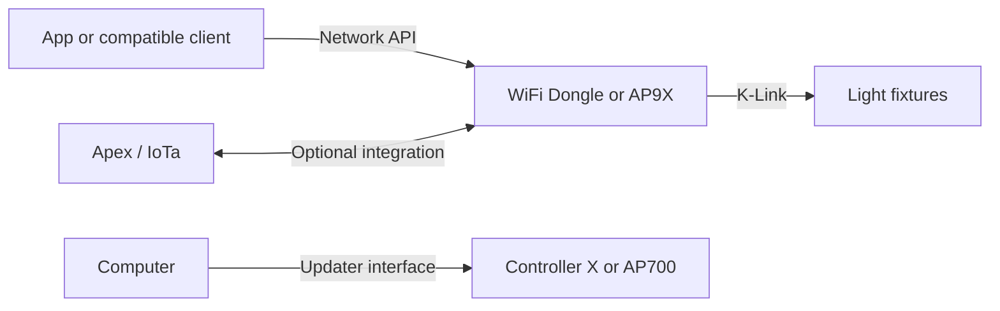

# Kessil protocol research

Start with the [WiFi Dongle protocol guide](wifi-dongle-protocol.md). The references below describe separate device interfaces and distinguish static analysis from hardware validation.

## How the interfaces fit together

The phone app or a compatible client communicates with a controller over its network API. The controller translates supported requests into K-Link messages for fixtures. Discovery, Apex/IoTa, firmware update, and Controller X USB are separate interfaces.

For the legacy light-control flow, `dtype:4` assigns a fixture KID to a group GID, while `dtype:3` writes channel values to a GID. A group write affects every fixture in that group, so individual control requires an exclusive group. An AP9X is type 1, the same as a Tuna Blue, so it can share a type-1 group. Controllers also send a once-per-second K-Link command `34` presence beacon; an AP9X that is acting as chain master treats a competing beacon as a reason to hand control over. The physical daisy-chain behavior and the two-controller handover have not been validated with a capture.

| Term | Meaning |
|---|---|
| KID / GID | Fixture identity / group selector used for channel writes |
| Network `dtype` | Request type in the controller's application API |
| K-Link command | Command byte in a fixture-bus message |
| Apex / IoTa | Separate controller-integration interface |
| USB updater | Host-to-controller firmware interface; not the fixture-control interface |

## References

| Topic | Reference |
|---|---|
| Legacy WiFi Dongle API | [WiFi Dongle API](wifi-dongle-api.md) |
| Dongle/AP9X replacement design | [Replacement feasibility](dongle-replacement.md) |
| Fixture-bus framing and addressing | [K-Link protocol](klink-protocol.md) |
| Controller presence and AP9X handover | [Command 34](klink-protocol.md#command-34-as-a-handover-beacon) |
| Neptune Apex / IoTa | [Apex / IoTa protocol](apex-iota-protocol.md) |
| Firmware update interfaces | [Firmware update notes](firmware-update.md) |
| Hardware and boot observations | [Hardware and boot notes](hardware-and-boot.md) |
| Controller X USB | [USB protocol](usb-protocol.md) |
| Discontinued AP700 | [AP700 protocol](ap700-protocol.md) |
| Evidence and open questions | [Evidence limits](protocol-evidence.md) |

## Evidence limits

Most findings come from static software analysis and public product documentation. No live Kessil device capture or firmware update has been performed. Protocol behavior may vary by model and firmware revision. Treat the update notes as descriptions of inferred interfaces, not as installation instructions. See the [project overview](../README.md) and [firmware analysis boundary](../firmware/README.md) for publication scope.
