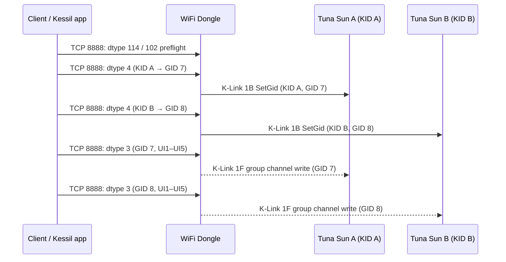

# K-Link protocol and multi-light topology

This reference separates the local TCP tunnel from the UART frames sent to fixtures. The USB updater and Controller X UART protocol are documented in [the Controller X notes](usb-protocol.md).

### Keep the three protocol labels separate

“Message type” is ambiguous in this system, so this reference uses these names:

| Layer | Field to name | Example | Meaning |
|---|---|---|---|
| App/client → WiFi Dongle JSON over TCP 8888 | `dtype` | `dtype:4` | Selects a Dongle API handler, here assign a lamp KID to a GID. |
| Dongle UART → K-Link fixture frame | command byte / opcode | byte 4 = `1B` | Selects a K-Link operation, here `SetGid`; it is carried inside the frame. |
| K-Link frame envelope | start marker | byte 0 = `A9` | Identifies the Dongle/AP9X frame format; it is not the operation code. |

For example, JSON `dtype:4` causes the Dongle to build K-Link opcode `1B`; it does not put the number `4` in the K-Link command byte. Controller X's analyzed UART receiver instead uses `D7` as its receive marker and emits `A9` frames; matching command numbers across those implementations do not prove identical framing or handler semantics. When discussing group membership, call the destination a **GID**; avoid calling it “the message type.”

## Addressing and controller roles

The recovered architecture is **controller-managed grouping**, but a formal master/slave protocol has not been established. The WiFi Dongle (and Controller X / AP9X software paths where applicable) initiates K-Link scans, queries, and writes. The available evidence does not show master election, bus-ownership negotiation, or whether fixture ports actively forward traffic.

`KID` and `GID` serve different purposes:

- **KID is the per-fixture bus address/identity.** Dongle discovery probes a KID range with command `18`; a responding fixture returns its KID, and later queries such as `1C` address a known KID. The source or generation of the initial KID on Tuna Sun/A360X fixtures is unknown from the analyzed firmware. AP9X's own STM firmware reads its KID from EEPROM, but that does not prove all fixture models use the same provisioning scheme.
- **GID is a group assignment.** The controller can address one fixture by KID with `SetGid` (`1B`) and provide a destination GID. The AP9X STM image contains a handler consistent with saving a KID/GID pair to EEPROM; its dispatch-table binding to opcode `1B` is inferred, and Tuna Sun persistence has not been demonstrated. Group channel writes (`1F`) address the GID, so every fixture assigned to that GID is subject to the same write.
- **The controller also keeps software-side inventory and group configuration.** It can persist and reconcile those records with fixture-reported state. `dtype:114` is only the Dongle's cached inventory; a raw `1C` query reports the fixture-side GID/type according to the recovered Dongle parser. Some refresh/scan paths can themselves change GID assignments, so the two sides can be stale or temporarily inconsistent.

Practically, the controller organizes **which fixtures belong to which groups**; the evidence does not show it creating ordinary fixture KIDs. KIDs are treated as identities that already exist when scanning begins. We do not know whether Tuna Sun/A360X KIDs are factory-programmed, generated by each fixture, or set by another commissioning process. We also lack a live capture proving how the two physical K-Link ports behave in a daisy chain. A model's default GID (for example, Tuna Sun to GID 2) is a type default, not a unique lamp address or evidence that GID identifies a physical port.

## Raw K-Link passthrough on TCP port 8888

The same `connection_handler` has a raw-frame branch alongside its JSON command parser. It classifies one received buffer as raw when byte 0 is `A9`, byte 1 equals the received byte count minus 3, and the final byte is `5C`; it then passes the exact received bytes to `WriteData` for transmission on the Dongle's UART. The TCP branch checks marker, length, and terminator but no checksum; callers should still form a valid K-Link checksum. This exposes a TCP-to-K-Link UART tunnel in the legacy Dongle firmware, separate from the JSON `dtype` API. Existing `A9` request examples below can be sent through this path, including KID-bearing queries and the KID-to-GID assignment command. Group command `1F` still addresses a GID and therefore affects all fixtures in that group.

The raw branch bypasses `cmd_parser` and `dispatch_cmd`, so it does not run the JSON API's lamp/group state-update or response-building logic. The effect of a raw assignment on the fixture's own persistence and on the Dongle's cached inventory was not established; inspect cached state with `dtype:114` and group state with `dtype:102`, and use a raw `1C` query for the current K-Link GID/type rather than assuming the JSON state was updated. Avoid `dtype:1` or `dtype:5` for passive verification because their `getInfo` path can itself send assignments when saved group type conflicts.

For example, a raw TCP request containing `A9 08 00 00 1C 01 12 A8 80 A1 5C` asks the K-Link bus for GID/model-type information about KID `0x0112A880`. The tunnel returns bytes read from UART directly, without a JSON envelope. Static analysis of the Dongle's `Validate` routine (`0x00415fe8`) establishes the accepted reply envelope: byte 0 is `A9`; byte 1 equals total reply length minus 3; byte 4 echoes the expected command; the final byte is `5C`; and the penultimate byte equals the checksum recomputed over the reply. The validator does not check bytes 2–3. For command `1C`, the caller reads reply byte 5 as GID and byte 6 as a zero-based type code, then stores type as that byte plus one. No live capture confirms these fields or any additional payload bytes, and the TCP handler still exposes whatever UART bytes arrive rather than parsing this envelope itself.

For a multi-read capture, save each returned byte string separately; do not infer frame boundaries from one TCP `recv` call. No query utility is included in this publication.

### Raw KID enumeration with command `18`

The Dongle's own `scanLamps` algorithm calls `Branch(lo, hi + 1)`, which sends command `18` with a 32-bit big-endian lower bound and exclusive upper bound. `hasLamp` accepts an 11-byte reply only when its `A9` envelope/checksum validates, then reads the responding KID from bytes 5–8; an ambiguous/collision reply causes the firmware to bisect the range and retry each half. The raw tunnel's `hasResponse` list includes command `18`, so this discovery request can be issued without invoking JSON `dtype:0`'s later inventory/group-reconciliation logic.

This discovery design is evidence that fixtures are **protocol participants**, not only passive cable repeaters: the controller varies a KID range and expects a lamp-side reply containing an identity, and treats multiple/ambiguous replies as a collision that it can resolve by subdividing the range. It does not mean each lamp forwards packets in software. In a daisy chain, the cable/port path may electrically expose all fixtures to a shared bus while each fixture listens and selectively responds; the firmware image does not reveal the two-port circuitry or prove that physical topology. Nor does this code show that fixtures exchange messages with one another. The best-supported current model is controller-to-fixture communication over a shared chain, with selective per-KID responses and GID-addressed group writes; fixture-to-fixture messaging remains unobserved.

Raw command-18 discovery can probe KID ranges and bisect malformed or colliding responses. This is active bus traffic, and the raw server treats each TCP `recv` as one frame, so fragmentation can invalidate a query. A `FAILED` response cannot distinguish an empty range from a UART timeout. Enumeration is therefore best-effort and cannot establish group exclusivity by itself; the response/collision behavior remains untested on hardware.

A chain inventory can combine raw command-18 enumeration with a command-`1C` identity query for each returned KID to compare GID/type values. Repeat observations before relying on group exclusivity; incomplete discovery and cached state can hide other group members.

The raw path can also perform the low-level individual-control sequence: assign the target KID to a GID used only by that fixture with command `1B`, then write the five channel bytes to that GID with command `1F`. For the illustrative KID `0x0112A880`, dedicated GID `3`, and channel bytes `10,20,30,40,50`, the requests are:

```text
Assign KID 0x0112A880 to GID 3: A9 09 00 00 1B 01 12 A8 80 03 9E 5C
Set GID 3 channels:             A9 0B 00 00 1F 0A 14 1E 28 32 03 00 3D 5C
```

Send each frame as a separate TCP request and wait for the tunnel's response before sending the next. Commands `1B` and `1F` are outside `hasResponse`'s readback set, so the handler writes the frame to UART but answers with `FAILED`; this is not a negative acknowledgement. A subsequent raw `1C` query or cached JSON `dtype:114`/group `dtype:102` response can be used to inspect assignment state, but `1F` output has no recovered readback and must be verified at the fixture. These frames are valid according to the recovered Dongle framing/checksum rules, not tested on hardware. The chosen GID must already be provisioned, type-compatible, and exclusive for independent output; the raw path does not enforce those conditions.

### Control frame interpretation

The assignment and channel-write examples above illustrate frame construction. Channel bytes are raw values, not calibrated percentages or named spectra. Confirm the target KID and exclusive, type-compatible GID before a write. Neither a successful socket operation nor the tunnel's ambiguous `FAILED` response proves fixture acceptance. Assignment can be checked using a validated `1C` query; emitted light must be checked at the fixture. See [the legacy API sequence](wifi-dongle-api.md#minimal-legacy-api-sequence-for-one-light-control).

The bridge has narrow reply handling. `hasResponse` (`0x00416100`) enables UART reads only for command bytes `08`, `18`, `19`, `1C`, `20`, `28`, `35`, and `F0`. For these, `WriteData` waits briefly and reads at most 50 bytes from UART before returning the bytes to TCP. For other command bytes it still writes the raw frame to UART, but returns no reply, which the handler converts to the ASCII text `FAILED`; a UART read timeout or lock contention can also produce `FAILED`. Therefore `FAILED` is not proof that a no-reply command such as `1F` was not transmitted or had no effect. If the scan lock is unavailable, the raw branch instead writes the two bytes `A9 5C`. These response behaviors are code-derived and have not been exercised on hardware.

The Android APK's UDP listener is a separate path from the Dongle v1.5.13 port-8888 `POLO` handler. Ghidra maps the APK receive worker to obfuscated class `Lha/m$b;`, method `a()`, and its configuration object to `Lad/r;`. The receive helper is configured with buffer size `0x400` (1024), local port `0x4b4c` (19276), timeout `15000` ms, and a final boolean `true` whose meaning has not been traced. It receives a datagram, converts the returned buffer to a string, parses JSON, and accepts only `cmd_reply_udp_broadcast` (`dtype:301`); the model carries `serial`, optional `version`, and `rssi`, with sender IP and cell-type value `0x65` (101) attached by the wrapper. The conversion code substitutes an empty string if `version` is absent.

AP9X firmware supplies the matching server path. Its `conn_app_udp_recv_thread` (`FUN_00415580`) creates a UDP socket, enables `SO_BROADCAST`, binds `INADDR_ANY:19276`, and receives up to 4096 bytes. `parser_parse_json_udp` (`0x00416da0`) requires integer `dtype:300` and reads `data` as a string; prefixes `android` and `iphone` are classified separately, with other values classified as unknown. For any parsed classification (0–2), the daemon obtains WiFi RSSI, calls `kd_json_response_udp` (`0x0041d178`) with the AP9X serial, RSSI, and `dtype:301`, then sends the serialized response to the source sockaddr returned by `recvfrom`. The helper creates exactly three JSON fields: `serial` (string), `rssi` (integer), and `dtype` (integer). RSSI comes from the active 2.4 or 5 GHz interface; if the band is unrecognized, it uses `-999`. The statically supported request and response shapes are:

The sample `rssi` value below is illustrative, not a captured measurement.

```json
{"dtype":300,"data":"android"}
```

```json
{"serial":"<AP9X serial>","rssi":-55,"dtype":301}
```

A descriptor-level scan of both code DEX files finds only the APK receiver’s `DatagramPacket` constructor, `DatagramSocket.receive`, packet getters, and socket close calls; it finds no datagram send call or `DatagramChannel` use. The `cmd_udp_broadcast` enum value (`dtype:300`) is initialized and included in the generated enum-values array, but no other field reference to that enum value appears in either DEX. This supports the conclusion that the supplied APK contains the AP9X reply receiver but no statically visible request sender. The archive-wide XAPK/APK check also found no native libraries, ruling out a bundled `.so` sender. It does not rule out reflective/framework-mediated behavior or a request sent by another app component; a packet capture or another app build is needed to settle that. Dongle firmware 1.5.13's separate UDP service still accepts up to 100 bytes on port 8888 and responds `POLO`; it does not implement the AP9X port-19276 handler in the recovered dispatch path.

The firmware-derived AP9X discovery request is a UDP broadcast to port `19276` with `{"dtype":300,"data":"android"}`; responses use `dtype:301`. This is a candidate discovery exchange, not a recovered implementation of the APK’s missing sender. Earlier LAN probes produced no valid replies, but no AP9X was confirmed present, so that result does not validate or refute the exchange.

The legacy Dongle UDP service receives a short text datagram on port `8888` and returns `POLO`; it does not route that probe through the JSON/K-Link handlers. Broadcast discovery reaches only the local broadcast domain and may be filtered. Earlier LAN probes produced no replies, leaving discovery unvalidated. Cached inventory uses a separate TCP `dtype:114` request.

## Physical layer: differential half-duplex serial on the USB-C data pins

Classification: **hardware observation** on one WiFi Dongle (firmware 1.5.13) and two A360X Tuna Sun fixtures chained with a USB-C cable, except rows marked **static analysis**. Single device set; not replicated on other models or fixture counts.

| Item | Result | Basis |
|---|---|---|
| Pins carrying data | The USB-C **D+** and **D-** pins of the fixture's K-Link port | Signal activity on both pins, probed at the fixture's second (daisy-chain) K-Link port while the Dongle sat on the first port |
| Signaling | **Differential**: D+ idles high, D- idles low, and both toggle with matching timing | Idle levels read as complementary; thousands of edges per minute on each pin while the Dongle talked |
| Framing | **8N1 serial at 115200 baud**; normal polarity on D+ (idle high, start bit low) | Raw pulse widths were integer multiples of 8.68 microseconds; decoding D+ alone gave about 1000 bytes with zero framing errors and about 90 valid frames |
| Duplex | **Half-duplex**: the Dongle's request and the fixture's reply appear on the same pair | A request and its reply (for example an identity query and the `A9 06 00 00 1C 02 01 DB 5C` reply) were both decoded from the same pin |
| Dongle firmware | Opens a serial device at `B115200`; raises a GPIO roughly 100 microseconds before each write and lowers it afterward; ships a test tool named `testRS485` that builds the unmute frame the same way | **Static analysis** of Dongle 1.5.13 |
| Power | The fixture supplies 5 V to the Dongle through the same port | Dongle rated 5 V DC, 400 mA; the Dongle boots from a 5 V source alone |

Interpretation: this is an RS-485-style differential pair on D+/D-, driven through a transceiver whose direction pin the Dongle's GPIO controls. D+ behaves as the non-inverting leg: a receiver whose non-inverting input is wired to D+ idles with its output high. Reading D+ alone, single-ended, was enough to decode every frame.

Not established: termination and bias, the voltage swing (the data pins were read as 3.3 V logic by a microcontroller input; the line voltage was not measured), whether the CC and SBU pins carry anything, the electrical limit on fixtures per chain, and whether a controller that drives the pair from two ordinary GPIO pins (without a transceiver) works. The measurement used a microcontroller recording pulse widths on a USB data pin through its RMT peripheral; no logic analyzer was used.

### Periodic traffic observed from the Dongle

- **Group channel writes** (command `1F`) about once per second per active group, carrying the interpolated schedule value. Consecutive frames were `A9 0B 00 00 1F 5D 2C 00 00 00 02 00 4B 5C` and `A9 0B 00 00 1F 5E 2C 00 00 00 02 00 4A 5C`: GID 2, UI1 93 then 94, UI2 44.
- **Interpolation check:** with a program whose adjacent points were 09:00 (UI1 51, UI2 12) and 11:00 (UI1 102, UI2 51), captures at about 10:40 carried UI1 93 then 94 and UI2 44. That matches linear interpolation between the points with truncation. The per-point `duration` value (30 in that program) did not produce a separate ramp window in this segment.
- **A payload-less command `34`** (`A9 04 00 00 34 C8 5C`) about once per second. Its purpose is unknown, and no reply to it was captured.

Whether the fixtures hold their last `1F` level without these repeats was not tested here.

## Dongle-to-light K-Link UART frames

The Dongle firmware constructs K-Link UART requests directly. Its `WriteData` routine serializes access to the UART, toggles a GPIO around transmission, and validates replies as framed packets. This gives an exact frame format for the Dongle's K-Link side; it should not be conflated with the Controller X firmware's separate receive parser, which recognizes `D7`.

| Offset | Meaning |
|---:|---|
| 0 | Start marker `A9` |
| 1 | Payload length `L`; total frame size is `L + 3` bytes |
| 2–3 | Two bytes emitted as `00` in the recovered builders; purpose not identified |
| 4 | Command/opcode |
| 5 onward | Command parameters/data |
| `L + 1` | Additive two's-complement checksum: negative sum of bytes 1 through `L + 0` modulo 256 (length plus reserved/command/data) |
| `L + 2` | Terminator `5C` |

The checksum helper loops from byte 1 to byte `frame_size - 3`, so the start marker, checksum, and terminator are excluded. Reply validation checks the `A9` marker, length consistency, expected command byte, checksum, and `5C` terminator. Multi-byte KIDs and scan bounds are serialized big-endian.

**Message type vs. command:** in the Dongle/AP9X `A9` K-Link builders documented here, byte 0 `A9` is the frame marker, bytes 2–3 are two zero-valued fields of unidentified purpose, byte 4 is the command/opcode, and byte 5 onward holds its parameters. Thus `18` in the branch example and `1F` in the group-control example are command bytes; these recovered frames do not expose a separate message-type/address byte. The term “message type/address” applies to byte 2 of the Controller X's distinct `D7` receive format below, not to the Dongle's byte-4 command.

### Independent confirmation in AP9X firmware

The AP9X WiFi image bundled by the same APK contains a symbolized `libk-link.so`. Its `klink_disc_unique_branch`, `klink_disc_mute`, `klink_disc_unmute`, `klink_read_z2t_gid`, `klink_get_status`, `klink_find_me`, `klink_read_gid_model_type`, `klink_read_fw_version`, `klink_get_model_name`, and `klink_get_input_value_by_kid` routines independently construct the same `A9` frames, use the same two-zero reserved prefix, big-endian KIDs, a checksum helper, and `5C` terminator as Dongle 1.5.13. This is strong cross-firmware confirmation of the framing and of commands `18`, `19`, `1A`, `1C`, `1F`, `20`, and `35`.

The AP9X library also exposes two control builders: `klink_set_input_by_group` sends command `1F` with five channel bytes, a selector byte, and a trailing zero; `klink_set_input_by_type` sends command `11` with five channel bytes and a type byte. In the daemon's manual-mode writer, the latter is called with type `00` after the five UI values are copied into the group state; this confirms one observed value and call context, but does not define other type values or show that this byte addresses a lamp. The app's `dtype:2` find-me request can include `SIDE` for lamp type 0. AP9X passes that value to `lamp_execute_findme`, which forwards it to `klink_find_me`; the library emits command `17` when the second argument is `-1`, and command `2B` with that argument serialized as the final selector byte otherwise. This links the network `SIDE` field to the `2B` selector, though the supported side values and their fixture-level meaning remain unknown. Before serialization, both control builders right-shift each channel argument by the global `klink_data` value when that value is positive; at zero they serialize the low byte of each argument unchanged. In AP9X `k-daemon`, `rs485_init_func` reads the `k-daemon.main.power_saving` UCI integer and passes its address to `klink_reg_callback`, which copies four bytes into `klink_data`. The bundled AP9X `/etc/config/k-daemon` sets `power_saving` to `0`, so its stock configuration does not shift the five channel arguments before byte serialization. This makes the AP9X channel byte scaling clearer, but does not map the five indices to named spectra on Tuna Sun or other fixture models. The group builder corroborates the Dongle's command `1F` layout, while command `11`'s type semantics remain incomplete.

The analyzed AP9X STM32L4 image also contains a reply serializer used by K-Link handlers including `KL_ReadKdnum` and `KL_SaveKidGid` (`FUN_0800626c`, `FUN_080070b0`). `FUN_08011258` writes an `A9` marker, obtains the frame length from a command-indexed table, puts a reply-data byte at offset 2, a caller-supplied byte at offset 3, echoes the command at offset 4, copies remaining reply bytes starting at offset 5, computes the two's-complement additive checksum over the length and following bytes, and appends `5C`. Its checksum helper `FUN_080113b0` confirms the same negative-sum calculation. This independently supports the distinction between the byte-4 command and bytes 2–3 in AP9X's fixture-side K-Link implementation; bytes 2–3 are caller/data fields, not a second command selector. Their exact meanings remain unresolved. The command-length table pointer resolves to `0x0801ABC4`, beyond the supplied 78,984-byte STM image's mapped range, so the reply lengths and complete per-command response schemas cannot be recovered from this payload. This is AP9X STM firmware evidence and does not prove that Tuna Sun or Controller X use identical response fields; no live frame was captured.

The same STM image's `KL_SaveKidGid` handler (`FUN_080070b0`) assembles a big-endian four-byte KID from request offsets 5–8, reads the GID from offset 9, and writes the KID and GID through EEPROM calibration entries `0x30` and `0x38` (`FUN_0800bbfc` and `FUN_0800bb64`). That is consistent with persistent handling of the `1B` KID/GID assignment frame on AP9X. The AP9X handler-to-opcode dispatch table is outside the supplied image, so the exact opcode binding is inferred from the `KL_SaveKidGid` name and matching field layout; this does not establish Tuna Sun fixture persistence.

The AP9X library has functions explicitly named `klink_read_fw_version_port_I` and `klink_read_fw_version_port_II`. The former sends `08` with no KID; the latter sends `94` with no KID, and each reads three version bytes. This shows that AP9X firmware distinguishes two port-specific version queries, but does not establish how either port is electrically wired or whether the same commands apply to Tuna Sun fixtures or the WiFi Dongle's pass-through ports.

| Command byte | Frame data | Recovered use |
|---:|---|---|
| `08` | none | Read lamp firmware version; `getInfo` selects the responding lamp by unmuting its KID first |
| `0C` | KID, 32-bit big-endian | AP9X library read: returns five one-byte input/UI values for a KID; `lamp_sync_ui_from_st` stores them in the group's five manual UI slots. Dongle 1.5.13's raw tunnel can forward the request frame, but its UART readback whitelist excludes command `0C`; it therefore returns `FAILED` instead of exposing any fixture reply. |
| `11` | five channel bytes, one type byte | AP9X `klink_set_input_by_type` control builder; AP9X manual-mode writer uses type `00`; other values and their semantics are unresolved |
| `17` | KID, 32-bit big-endian | Find/identify a light |
| `18` | lower and upper KID bounds, each 32-bit big-endian | Branch/range query for lamp discovery |
| `19` / `1A` | KID, 32-bit big-endian | Mute / unmute one KID; `FFFFFFFF` is used for all lamps |
| `1B` | KID (32-bit big-endian), GID (one byte) | Assign lamp to group |
| `1C` | KID, 32-bit big-endian | Dongle `getInfo` reads response data byte 5 as the lamp's GID and byte 6 plus one as its lamp type. This feeds inventory/query state. AP9X `libk-link.so` has a matching `klink_read_gid_model_type` wrapper returning those two bytes, but that wrapper is marked unreferenced in the AP9X daemon. Dongle's `GetAll` and `GetGid` builders emit this request frame. |
| `1F` | five one-byte channel values, GID byte, trailing `00` | Apply manual group channel values |
| `20` | none | Read model |
| `23` | two one-byte parameters | AP9X `klink_set_fan_index` setter; meanings/ranges and Dongle support are unverified |
| `24` | none | AP9X `klink_get_fan_rpm` read; combines two reply bytes little-endian into an RPM value. Dongle support is unverified. |
| `27` / `28` | Set: KID plus two GID bytes; Get: KID | Set / read AP9X dual-group identifiers |
| `33` | KID, 32-bit big-endian, plus one control byte | AP9X `klink_keypad_ctrl`; `lamp_sync_ui_from_st` uses value `00`. Exact control meaning and Dongle support are unverified. |
| `2B` | KID, 32-bit big-endian, plus one selector byte | AP9X `klink_find_me` variant; selector is forwarded from app request field `SIDE`; supported values and fixture-level meaning unresolved |
| `35` | KID, 32-bit big-endian | Dongle `getInfo` sends this request and stores successful reply byte 5 as `1` only for `06` (otherwise `0`); query failure is stored as `-1`. AP9X `libk-link.so`'s unreferenced `klink_get_status` wrapper instead maps both `06` and `80` to `1`. Dongle does not serialize its stored result in the inspected JSON responses; the status meaning is unknown. |
| `36` | KID, 32-bit big-endian | AP9X library `klink_read_status` variant; sends the request but discards the response and returns `0`, so no status value is exposed by this wrapper. Daemon use is unverified. |
| `92` | one byte | AP9X `klink_12_chan_and_fan` diagnostic: sends value `01` in its check path and logs fourteen reply bytes; field meanings and Dongle support are unverified |
| `94` | none | AP9X port-II firmware version query; port-I query uses `08` |

The AP9X `libk-link.so` library implements command `35` (`klink_get_status`) by checking the first reply data byte at offset 5: `06` and `80` map to Boolean true, all other values map to false. The Dongle's `getInfo` routine independently sends its own command `35` request and stores a successful reply's byte 5 as a Boolean (`06` → `1`, anything else → `0`; query failure → `-1`) in its 64-byte internal lamp record. However, the `printLamp` serializer does not include that record slot: both the per-lamp `dtype:1` response and inventory `dType:5` response serialize KID, group IDs, model, firmware, type, temperature, and timestamp, with no status field. So the Dongle firmware queries and retains this status result internally, but the inspected JSON interface does not expose it. The status-byte meaning remains unknown; do not interpret the Boolean as confirmed power state or online state.

The Dongle's `getInfo(KID)` routine uses a KID-selection window to associate replies from commands that do not carry a KID. It sends `Unmute(KID)`, then queries status (`35`, KID-bearing), firmware version (`08`, no KID), GID/type (`1C`, KID-bearing), and model (`20`, no KID); if the reported model begins with `AP9X`, it also queries the two group IDs with `GetZGid`. Before returning, it sends `Mute(KID)`. After querying, it compares the reported lamp type with the saved type of its current group; if they differ, it sends `SetGid` to the type's default group (1→1, 2→2, 3→26). The AP9X path can also send `SetZGid` when its two reported group IDs conflict with saved group types. Thus this is not a pure query path. The `08` firmware-version read occurs after unmuting the selected KID and before muting it, so `getInfo` can attach that unaddressed reply to the requested lamp record. This call order is recovered from Dongle 1.5.13 static code; it does not establish electrical arbitration or prove how simultaneous responders behave on physical hardware.

**Hardware observation (Dongle 1.5.13 in router/station mode, two A360X Tuna Sun fixtures running FW 1.3 in one group; identifiers below are synthetic).** Raw command `18` range queries and raw `1C` queries returned the tunnel's `FAILED` text within about 30 ms, even though JSON `dtype:102`/`dtype:114` succeeded and the fixtures were powered. Fixtures that the Dongle had muted ignored both commands. For a fixture with KID 18001234, sending unmute `A9 08 00 00 1A 01 12 AD 52 CC 5C` (the tunnel itself replied `FAILED`), then `A9 08 00 00 1C 01 12 AD 52 CA 5C`, returned `A9 06 00 00 1C 02 01 DB 5C`, which parses as GID 2, type 2 and matched the cached inventory. Mute `A9 08 00 00 19 01 12 AD 52 CD 5C` then returned `A9 05 00 00 19 FF E3 5C`, and a repeated `1C` failed again. A fast `FAILED` on `18`/`1C` therefore does not show that a fixture is absent; it may only be muted. Raw group channel writes (`1F`) took effect on the muted fixtures. Classification: observed on hardware; the meaning of the `19` reply bytes is not established.

The Dongle's `Validate` routine (`0x00415fe8`) accepts a reply only when it has the `A9` marker, the length relation `byte[1] == total_length - 3`, the expected command at byte 4, a matching recomputed checksum in the penultimate byte, and a final `5C`. It leaves bytes 2–3 unconstrained. This is the Dongle's internal reply validation; the TCP raw-frame handler does not invoke it on replies. The command `1C` caller resolves reply bytes 5 and 6: it stores byte 5 as the lamp's GID and byte 6 plus one as its lamp `type`, then uses them to reconcile the lamp inventory and its group assignment. Thus the reply envelope and these two field interpretations are recovered from Dongle 1.5.13 code, although no live reply was captured. The AP9X daemon's dynamic symbol table contains `klink_get_status` and `klink_read_gid_model_type`, but `DT_MIPS_UNREFEXTNO=36` marks dynamic symbol index 36 and later as unreferenced in that executable; the functions are at indexes 298 and 248, respectively. The [MIPS ABI](https://refspecs.linuxfoundation.org/elf/mipsabi.pdf) defines this tag as the first external symbol not referenced within the object. Ghidra also recovered no direct code references to those AP9X wrappers. Therefore the AP9X status-byte Boolean remains a library capability only, while the `1C` GID/type interpretation is directly supported by the Dongle's inventory caller.

Examples generated from the recovered builders (checksum calculated by the firmware's `checkSum` algorithm). The complete worked `A9` frames in the USB and WiFi protocol notes were also checked against the documented `frame_size = L + 3` rule and zero-sum checksum; this validates the examples' internal consistency, not device acceptance:

```text
Mute all:             A9 08 00 00 19 FF FF FF FF E3 5C
Unmute all:           A9 08 00 00 1A FF FF FF FF E2 5C
Scan first range:     A9 0C 00 00 18 01 12 A8 80 02 25 51 01 28 5C
Set KID 0x0112A880 to GID 2:
                      A9 09 00 00 1B 01 12 A8 80 02 9F 5C
Read five input/UI values for KID 0x0112A880:
                      A9 08 00 00 0C 01 12 A8 80 B1 5C
Read status byte for KID 0x0112A880:
                      A9 08 00 00 35 01 12 A8 80 88 5C
Set GID 1 channels 10,20,30,40,50:
                      A9 0B 00 00 1F 0A 14 1E 28 32 01 00 3F 5C
```

The AP9X `lamp_sync_ui_from_st` path demonstrates one use of command `0C`: it reads the AP9X ST KID and GID from configuration, unmutes that KID, calls `klink_get_input_value_by_kid` for five returned values, sends command `33` with that KID and control byte `00`, waits 300 ms, then mutes the KID again. The five values are copied into the GID's five manual UI slots. This is a lower-level K-Link read; it is distinct from the port-8888 `dtype:1` network query, whose response contains lamp identity/state fields and is not established as channel-value readback. The command builder proves the KID request and five output values, but the physical response offsets and model-specific channel labels/scaling are not established.

The first scan range uses decimal bounds 18,000,000 through 36,000,001 (exclusive upper bound); recursive splits send each lower bound and one-past-inclusive upper bound.

#### Scan side effects (`dtype:0`)

The `dtype:0` scan handler is state-changing beyond discovery: `scan_handler` (`0x00428490`) scans and calls `getLampsInfo`, whose `getInfo` calls can already reconcile lamp/group type mismatches. The scan handler then compares each returned lamp type with the saved type of its current GID; if they still differ, it sends K-Link `SetGid` (`1B`) with that lamp's KID and a destination GID equal to the lamp's numeric type, then saves group state. Thus `dtype:0` can move lamps and persist the changed assignments; do not treat it as a harmless read-only inventory request. The exact mismatch paths are recovered from Dongle 1.5.13 static code and have not been induced on hardware.

#### Query side effects (`dtype:1`, `dtype:5`, and `dtype:114`)

`dtype:1` and `dtype:5` call `getInfo` for live K-Link queries. After reading a lamp's type and GID, `getInfo` compares that type with the saved type for the current GID; on a mismatch it sends `SetGid` (`1B`) to the model's default group (type 1→GID 1, type 2→GID 2, type 3→GID 26). For AP9X records, the same routine can send `SetZGid` (`27`) when the configured group types conflict with the reported dual-group IDs. `dtype:5` calls this path for every cached lamp, so it is a refresh that can mutate K-Link assignments, not a passive read. `dtype:114`, by contrast, calls `printLamps` on the cached lamp records and does not call `getInfo` or query K-Link; its inventory may be stale, and its response also includes Dongle serial and WiFi fields. It is available through the legacy dispatcher only when `APEX_FLAG` is clear. The capture helper uses `dtype:114` and omits/redacts sensitive fields. These behaviors are statically recovered from Dongle 1.5.13 and have not been tested on hardware.

For manual control, the APK's legacy builder takes a five-element integer array and serializes array positions 0–4 as `UI1`–`UI5`; the newer `dtype:323` builder serializes the array under `UI`. Dongle/AP9X K-Link builders then write those five values in order as bytes 5–9 of command `1F`. The wire representation contains numeric slots, not spectral names such as `VI` or `Amber`. Kessil's Signal Converter guide maps Tuna Sun K-Link channels in K-Link-to-DMX mode. This independently identifies the function of the K-Link channel slots, though it does not establish WiFi API numeric scaling or fixture output calibration. The APK labels its Tuna Sun `UI5` control “VI,” while the converter maps K-Link channel 5 to amber (details below).

The network API's `dType:4` assigns a KID to a GID and the `dType:3` manual control request writes five values to a GID. Dongle 1.5.13 validates `UI1` and `UI2` in 0–255 (with `UI2` capped at 240 for group type 3), and `UI3`–`UI5` in 0–100. The documented path to independent control is therefore to put one light in a group by itself, then set that group's channels. The packet path is statically resolved, but a live one-light/two-light test is still needed to verify the app's behavior and map all fields to each model's emitted output.

## Two-light K-Link topology reported by the owner

The owner reports a working physical arrangement of two Kessil Tuna Sun fixtures, each with two K-Link ports: the WiFi Dongle occupies one port on one fixture, and a standard USB-C-to-USB-C cable connects the remaining port to a port on the second fixture. This is user-reported topology evidence, not a packet trace or electrical measurement. Kessil's WiFi app manual says one WiFi Dongle can serve an A360X K-Link chain of up to 32 lights, and Kessil's current [FAQ](https://kessil.com/support/faq.php) likewise says a Dongle is not needed for every light and that one can control up to 32 daisy-chained lights. The manual describes the dashboard's lamp count per group and moving a lamp by dragging it to another group. Combined with the recovered `dtype:4` KID-to-GID assignment and `dtype:3` group channel write, this supports individual control through the **Kessil app**: assign the target KID to a GID containing only that lamp, then set that GID's channels. This is separate from the Apex guide's mirrored-schedule behavior and requirement for a Dongle/Apex attachment per lamp for independent control through Apex. Both the app manual and Kessil's current [WiFi Dongle A4 hardware manual](https://kessil.com/downloads/accessories/5870137_A4_User%20Manual%20for%20WiFi%20Dongle.pdf) warn against daisy-chaining two fixtures that each have WiFi Dongles; the A4 manual also says not to connect a Dongle and Spectral Controller X to the same fixture. These warnings do not conflict with Kessil's one-Dongle-per-chain guidance or the owner's reported one-Dongle/two-light arrangement.

The recovered individual-control path has two addressing stages. `dtype:4` selects a fixture by KID and assigns it to a GID; `dtype:3` selects that GID and sends the five channel values. A channel write is group-scoped, so every fixture on the K-Link bus assigned to that GID can receive the same output. The following is the firmware-derived message path, not a captured serial trace:



The `1B` and `1F` arrows show the addressed fixture/group behavior recovered from the handlers; they do not imply separate point-to-point wires. Both frames travel on the shared K-Link bus. The exclusive GID mapping is what separates the two channel writes.

### AP9X chain direction and control ownership

Kessil's current [AP9X user manual](https://kessil.com/downloads/AP9X/5870142_A8_X1_User%20manual%20for%20Kessil%20AP9X.pdf) adds device-level evidence about control ownership on an AP9X K-Link chain. It says the AP9X's local controls are disabled when Wi-Fi is on or when a K-Link signal is input (the manual gives Spectral Controller X as an example). Its mode indicator is solid green when local controls are enabled and the AP9X can control other K-Link fixtures; in the multi-AP9X scenario, only the master AP9X has Wi-Fi on and the other fixtures have Wi-Fi off. In its connected Wi-Fi state, the master AP9X's mode indicator is solid blue and its control buttons are disabled. This supports a single upstream control source for that AP9X chain and helps distinguish controller/input from downstream-control operation. The manual does not specify the electrical direction or packet-forwarding implementation, and these AP9X mode behaviors should not be assumed for Tuna Sun fixtures or the WiFi Dongle.

| AP9X manual state | Documented behavior | What it establishes |
|---|---|---|
| K-Link signal input (for example, Spectral Controller X) | Local control buttons disabled | The AP9X recognizes an externally driven K-Link condition. |
| Solid green mode indicator | Local controls enabled; AP9X can control other K-Link daisy-chained fixtures | AP9X can act as a controller for downstream fixtures. |
| Wi-Fi master connected; solid blue mode indicator | Master controls disabled; Wi-Fi remains on at the master | A Wi-Fi-controlled AP9X chain has one master and Wi-Fi-disabled slaves. |

These are manual-described AP9X states, not a capture and not a wire-level relay proof. The Tuna Sun two-light topology below remains supported separately by the owner's report, the Dongle's KID/GID discovery and group-control implementation, and Kessil's A360X chain guidance.

For two chained Tuna Suns in normal Kessil mode (`APEX_FLAG` clear), the firmware-derived individual-control sequence is: inspect cached records with `dtype:114` and confirm both known KIDs; if a KID is missing, try raw command-18 enumeration before considering JSON `dtype:0`; use `dtype:102` to confirm two existing groups with type 2 (or create unused GIDs 3–25 with `dtype:103`, `name`, and `type:2`); verify current K-Link GID/type with raw `1C` queries; assign KID A to GID A and KID B to GID B with separate `dtype:4` requests; then send independent `dtype:3` channel writes to each GID. JSON `dtype:0`, `dtype:1`, and `dtype:5` can move lamps when group types conflict. Read back group configuration with `dtype:102` and cached inventory with `dtype:114`. Do not reuse one GID for both fixtures if independent output is required, because command `1F` writes to every lamp in the destination group. Creating a group overwrites its configured name and type, so first verify the chosen GID is unused. This sequence follows the recovered Dongle 1.5.13 handlers and assumes the chain is discovered as reported; the exact two-fixture bus exchange and each lamp's physical response have not been captured.

With two already-created type-2 groups (here GID 7 and 8) and KIDs obtained from cached `dtype:114` records or raw command-18 enumeration, the independent assignment and control requests are:

```json
{"dtype":4,"data":{"KID":"18001234","GID":7}}
{"dtype":4,"data":{"KID":"18001235","GID":8}}
{"dtype":3,"data":{"GID":7,"UI1":10,"UI2":20,"UI3":30,"UI4":40,"UI5":50,"save":1,"enabled":1}}
{"dtype":3,"data":{"GID":8,"UI1":80,"UI2":60,"UI3":0,"UI4":0,"UI5":0,"save":1,"enabled":1}}
```

Send each JSON object as its own TCP request to port 8888 and handle its response before sending the next. These sample KIDs and channel values are illustrative; use the actual KIDs returned by inventory. The sequence is safe to apply only after confirming GIDs 7 and 8 exist, are unused or intentionally dedicated, and have type 2. The two `dtype:4` operations move each lamp independently; the following `dtype:3` operations address the groups. This demonstrates the documented API semantics for separate control on a shared chain, but it is not a captured exchange and does not verify the particular two-light cable arrangement against hardware.

Kessil's [A360X user manual](https://kessil.com/downloads/A360X/5870131_A5_User%20Manual%20for%20A360X_OL.pdf) names the connection a “Type-C USB Cable (K-Link Cable)” and shows the cable joining fixtures. This confirms Kessil's connector/cable terminology, but does not establish that the link uses USB signaling or USB-C CC negotiation. The Controller X firmware's 115200-baud UART framing is evidence for a serial K-Link implementation on that controller, but it does not establish the pin mapping or exact PHY used by Tuna Sun fixtures and the WiFi Dongle. Do not assume that Controller X's UART frames are identical to Dongle-to-light traffic until captures or board evidence connect them.

For a Dongle-side cached-inventory capture, a TCP `dtype:114` request returns cached lamp records without querying K-Link. Compare captures with one fixture and then two fixtures, recording KID, model, firmware, GID, and left/right GIDs. Redact device identifiers and any Wi-Fi credentials before sharing captures. Raw command-18 discovery and command-`1C` identity replies can supplement that cache, but discovery may be incomplete; validate reply marker, length, command, checksum, and terminator. JSON `dtype:0`, `dtype:1`, and `dtype:5` can reconcile and change group assignments, so do not treat them as passive observations. A serial capture requires confirmed electrical levels and an appropriate high-impedance analyzer.

The APK exposes manual intensity as a **group-level** request (`GID`, five `UI` values). The legacy manual-screen handler (`fragment.e::d3`) obtains the selected `Group.getUI()` array and passes it to `function.b::i`; that builder writes array positions 0–4 directly as `UI1`–`UI5`, with no reordering. A program-point handler (`fragment.g::e3`) similarly passes `Points.getUI()` through the same builder. The separate lamp/group request uses `KID` and `GID`, so individual fixture control through this path appears to require placing that fixture in a group by itself, then setting that group's UI values; this remains to be confirmed in a live test. The [Kessil WiFi app manual](https://kessil.com/downloads/accessories/kessilwifi_UserManual/wifi_user_manual.html) describes Manual Mode as a color control and intensity control plus VI, red, and green adjustments; it does not map those labels to `UI1`…`UI5`. APK analysis resolves Tuna Sun app slider labels for `UI4` and `UI5`, while the Signal Converter guide supplies an independent but partly conflicting K-Link/DMX function map. Firmware strings include channel labels `WHITE`, `6000k`, `9000k`, `AMBER`, and `PURPLE-BLUE`; the complete mapping across models and firmware paths, including `UI3`, remains uncertain.

The [Neptune/Kessil IoTa guide](https://www.neptunesystems.com/downloads/docs/IoTa-Kessil_A360X_and_AP9X_User_Guide.pdf) says the Kessil app controls the Tuna Sun core with one setting continuously variable between 6000K and 9000K, while Apex exposes those as separate 6000K and 9000K channels. Kessil's [Signal Converter Box guide (edition 20240108A)](https://kessil.com/downloads/accessories/Kessil%20Signal%20Converter%20user%20guide-20240108A.pdf) independently documents a five-channel Tuna Sun mapping specifically in DMX-to-K-Link mode: channel 1 intensity (0–100%), 2 CCT (9000K–6000K), 3 unused, 4 red, 5 amber (both 0–100%). The guide also says the default GID is 2 for Tuna Sun, 1 for Tuna Blue, and 26 for Refugium, and that Auto Detect can reassign a fixture to another group. This independently supports the recovered model/type-to-GID mapping, though it documents the converter workflow rather than the WiFi app API. The ranges are documented for DMX; the guide does not establish how those DMX values translate to numeric WiFi API/K-Link bytes or prove identical labels across firmware paths.

The APK's group model and manual screen give app-level semantics for the first two values: `Group.getModeIntensityAngle()` reads `Group.getUI()[0]`, and the manual screen converts that value as intensity while passing `Group.getUI()[1]` through `getModeColorString()`. This supports `UI1` as intensity and `UI2` as the app's color/CCT control. The Signal Converter guide's channel 1/2 mapping independently agrees on intensity and CCT. The program-point editor (`fragment.g::h3`) has model-specific visibility: for a Tuna Sun point it loads `Points.getUI()[2]` into its first seek bar and `[1]` into its second; for Tuna Blue it loads indices `[0]`, `[1]`, and `[2]`. Thus Tuna Sun's program editor exposes `UI3` and `UI2`, although the recovered UI code does not give the first control a semantic label. Kessil's [WiFi app manual](https://kessil.com/downloads/accessories/kessilwifi_UserManual/wifi_user_manual.html) labels the auxiliary manual and program-point controls collectively as “VI & Red & Green Bars,” but does not map those labels to `UI` indices or specify a Tuna Sun-specific mapping; it therefore does not resolve Tuna Sun `UI3`. The manual-screen listener (`fragment.e::onProgressChanged`) ties Tuna Sun's first slider to VI: its `[vi]` branch uses a product-type switch, and enum `TS` selects array index 4. The second slider's `[red]` branch writes array index 3. Because the request builder serializes array positions 0–4 as `UI1`–`UI5`, the APK Tuna Sun manual-control path maps `VI → UI5` and `red → UI4`. Kessil's [Signal Converter guide](https://kessil.com/downloads/accessories/Kessil%20Signal%20Converter%20user%20guide-20240108A.pdf) independently maps the five Tuna Sun K-Link channels as intensity, CCT, unused, red, and amber in K-Link-to-DMX mode. This supports `UI4`/channel 4 as red, `UI5`/channel 5 as amber, and `UI3`/channel 3 as unused at the K-Link function level; the APK's “VI” label for its `UI5` control is therefore a UI-label discrepancy, not evidence that the fifth wire slot is violet/indigo. A separate APK `[green]` branch writes array index 4 for other product-type cases; do not apply that label to Tuna Sun, where the APK selects index 4 through the VI path. The converter guide documents DMX ranges, not the WiFi API's numeric encoding, and does not measure the fixture's emitted spectrum.

This is the evidence crosswalk for a Tuna Sun group. UI values are serialized in index order, but the API's accepted ranges differ from the converter guide's DMX ranges; equal index does not imply equal numeric scale.

| Wire slot | APK 1.15.3 Tuna Sun evidence | Kessil Signal Converter guide | Assessment |
|---|---|---|---|
| `UI1` | Intensity/angle control | Channel 1: intensity, 0–100% | Function agrees; scale conversion to API bytes is unknown. |
| `UI2` | Color control | Channel 2: CCT, 9000K–6000K | Function broadly agrees; exact value encoding is unknown. |
| `UI3` | No Tuna Sun-specific label recovered; Tuna Sun program editor exposes `Points.UI[2]` as its first seek bar | Channel 3: unused | K-Link-to-DMX documentation marks channel 3 unused. The API still accepts and transmits a value for positive-type groups. |
| `UI4` | Red slider | Channel 4: red, 0–100% | Function agrees; scale conversion is unknown. |
| `UI5` | VI slider | Channel 5: amber, 0–100% | K-Link function is documented as amber; APK's “VI” slider label conflicts with that function mapping. Numeric API encoding is unresolved. |

The Dongle firmware validates `UI1`/`UI2` in 0–255 (with a type-3 exception for `UI2`) and `UI3`–`UI5` in 0–100. The converter guide documents DMX ranges, not the WiFi API's numeric encoding. Use the numeric UI request schema for transport; interpret Tuna Sun K-Link channel 5 as amber while retaining the APK's inconsistent “VI” control label as a software/UI naming mismatch.

There is also a firmware-side label source: the AP9X IOTA `light.get` capability profile for selector 2 advertises `6000K`, `9000K`, `RED`, and `AMBER` (see the [compiled profiles](apex-iota-protocol.md#apex-integration-service)). This independently supports amber as a Tuna Sun capability, but the profile's four color entries do not map them to five `UI` indices or explain why the APK labels the fifth control “VI.” The direct K-Link-to-DMX mapping above is the evidence that ties amber to channel 5.

The Dongle firmware connects those fields directly to the K-Link writer: for a nonzero group type, `groupKnob` passes `UI1`…`UI5` in order to `SetKnobGroup`, which places them at frame offsets 5–9 of command `1F`; the group selector is at offset 10 and the trailing zero at offset 11. The TCP handler validates `GID` in 1–40, uses that same value as the group-table index, and passes it unchanged to `groupKnob` and `SetKnobGroup`; the selector byte is therefore the raw `GID`, with no `GID-1` adjustment. For group type `0`, the firmware instead passes `UI1` and `UI2` and explicitly zeros the remaining three channel bytes. Thus a Tuna Sun group must have its matching positive lamp type (the APK's type enum identifies Tuna Sun as `TS`, numeric type 2) for its `UI4` red and `UI5` amber values to reach this command; type 0 is not sufficient even though `dtype:4` accepts it as a compatible assignment target. The AP9X `klink_set_input_by_group` builder uses the same byte order, but can right-shift channel values according to its `klink_data` setting; the bundled AP9X configuration sets that shift to zero. This closes the statically recovered app → TCP field → Dongle K-Link-byte mapping, but not numeric scaling or measured physical output.

For the illustrative `dtype:3` request above (`GID=7`, `UI=[10,20,30,40,50]`) on a type-2 group, Dongle firmware constructs this K-Link command-`1F` frame:

```text
A9 0B 00 00 1F 0A 14 1E 28 32 07 00 39 5C
```

Here `UI4=40` (red) is byte `28` at offset 8 and `UI5=50` (amber channel) is byte `32` at offset 9. The APK's “VI” slider label conflicts with the documented channel function; the wire example establishes only the index/value encoding. Checksum `39` is the two's-complement additive checksum. This is a statically derived frame example, not a live capture.
